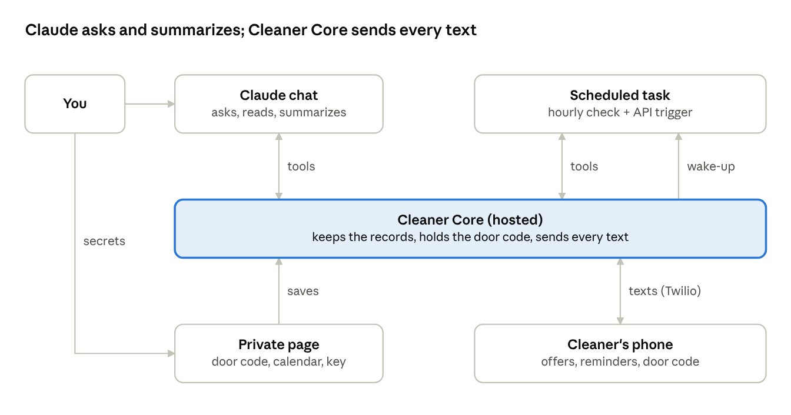
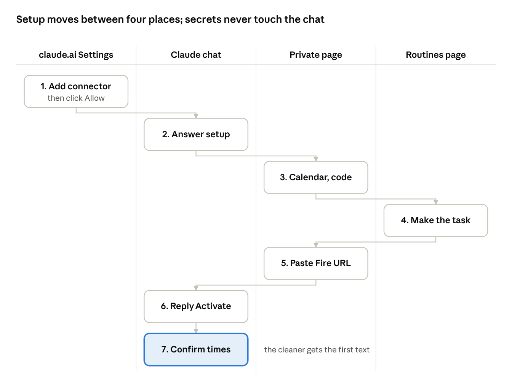

# Set up Cleaner Core with Claude

Claude runs Cleaner Core through one custom connector and one scheduled task. Grok Bot does both from its template; in Claude you add the connector and make the task yourself, which takes about 15 minutes.

## At a glance

You talk to Claude; secrets go straight from your browser to Cleaner Core; the scheduled task wakes whenever the cleaner texts.

## Setup path

Adding the connector and making the scheduled task are the two steps Grok Bot doesn't need; everything else is the same conversation.

## Before you start

You need four things before step 1. The Cleaner Core address is the same for everyone: `https://tourcore-production-8b80.up.railway.app/mcp/cleaner-core`.

| What | Why | Where it comes from |
| --- | --- | --- |
| A Claude Pro, Max, Team or Enterprise plan | Scheduled tasks (alerts and hourly checks) need one; Free allows the connector but no task | Your Claude account |
| An invite code from Saad | It links your Claude to your own Cleaner Core account. You type it once, when you connect | Saad |
| Your phone and the cleaner's phone approved for texts | Activate is refused until both numbers are on the operator's list | The Cleaner Core operator |
| On a Team or Enterprise plan: an Owner | Only Owners can add a custom connector for the org | Your Claude admin |

Your invite code puts your Claude in your own Cleaner Core account. Other hosts on the same service never see your property, people, or texts.

## Step 1: Add the Cleaner Core connector

You add the connector once, and every Claude app and the scheduled task share it.

1. Open [claude.ai/customize/connectors](https://claude.ai/customize/connectors).
2. Click **+ Add**, then **Add custom connector**.
3. Fill in the dialog as in the table below, then click **Add**.
4. On the page titled **Connect Claude to Cleaner Core**, type the invite code from Saad in **Invite code from Saad**, then click **Allow**.
5. If your bookings are in Google Calendar, also connect Claude's **Google Calendar** connector.

| Field | Choose | Why |
| --- | --- | --- |
| Name | Cleaner Core | Any name works; this one matches the guide |
| URL | `https://tourcore-production-8b80.up.railway.app/mcp/cleaner-core` | The Cleaner Core service. Every host and every chat uses this address |
| Authentication | Sign in now | Cleaner Core uses OAuth |
| OAuth client | Leave what Claude detects | Either **Use Claude's published identity** or **Register automatically** works. The invite code, not the client, decides whose Cleaner Core this is |
| Advanced | Leave as is | Nothing to change |

On a Team or Enterprise plan, an Owner adds it instead at **Organization settings → Connectors → Add → Custom → Web**, with the same settings. Then each person clicks **Connect** under Customize → Connectors and types their own invite code.

Add it only once. If you also want Grok or ChatGPT on the same Cleaner Core account, ask Saad for another invite code for that chat.

## Step 2 (optional): Add the cleaner-core skill

The connector already carries Cleaner Core's instructions, so setup works without this. The skill adds the full guide for edge cases.

- **claude.ai, desktop, Cowork:** zip the `claude-template/plugin/skills/cleaner-core` folder from [the repository](https://github.com/saadvz/TourCore) and upload it in **Settings → Capabilities → Skills**.
- **Claude Code:** run `/plugin marketplace add saadvz/TourCore`, then `/plugin install cleaner-core@tour-core`.

Skip this if your org blocks uploaded skills or plugins.

## Step 3: Run setup in a chat

Open a new chat, check that Cleaner Core is on under **+**, and say **Set up Cleaner Core**. Claude asks one question at a time:

1. What you want help with: pick scheduling cleaners.
2. The property: business name, address, usual checkout and check-in times.
3. Where bookings come from: Guesty Lite, Google Calendar, or another calendar link.
4. The people: you, the cleaner, and one-to-one texts or a group.
5. The schedule: how far ahead the cleaner is offered each cleaning, the reminder, quiet hours.
6. The locks, then the door code.
7. Your checklist and other preferences.

Claude asks one question per message. After the preferences, it hands you the scheduled task (step 4).

Secrets never go in the chat. For a calendar link and the door code, Claude sends a private Cleaner Core link instead. Open it, type the value, click **Save**, and tell Claude it's saved. Each link works once and expires in 10 minutes; ask for a new one if it runs out.

## Step 4: Make the scheduled task

The task comes before Activate, so the cleaner's first reply already wakes it. It checks your calendar every hour and wakes when the cleaner texts. Activate is refused until it's connected.

1. Open [claude.ai/code/routines](https://claude.ai/code/routines) and click **New task**, then **Set up manually**.
2. Fill it in as below and click **Create**.
3. The API trigger shows a **Fire URL** and a **token** once. Copy both; don't paste them into the chat.
4. Tell Claude you have them. It sends a private link. Paste both there and click **Save**; the page says **Alerts are connected.**
5. Within a minute, a run of the task replies **Cleaner Core alerts are connected.** That proves the wake-up works.

| Setting | Choose |
| --- | --- |
| Name | Cleaner Core |
| Prompt | The one Claude gives you, unchanged (also in [routines/cleaner-core-task.md](routines/cleaner-core-task.md)) |
| Trigger 1 | Schedule: hourly, a few minutes past the hour |
| Trigger 2 | API (click **+** in the Trigger row) |
| Repository | None |
| Connectors | Cleaner Core only, plus Google Calendar if you use it; remove the rest |

Remove every other connector. A scheduled task can use all its connectors' tools without asking.

## Step 5: Activate and confirm the times

1. Claude summarizes your setup. Reply **Activate**.
2. Claude asks for the first booking's times. Pick the usual times, or set them one turnover at a time.
3. The cleaner gets one text: "Reply YES to get cleaning texts, or STOP to opt out."

From here, each reply from the cleaner starts a task run that tells you what needs you. Open the run to answer it, for example "yes, the guests have left" to send the door code.

## Troubleshooting

Every row here came up during testing.

| What you see | Cause | Fix |
| --- | --- | --- |
| "That invite code isn't right", "has expired", or "was already used" | Each invite code works once, for 7 days | Ask Saad for a new invite code, then click **Connect** again |
| "This connection isn't linked to a Cleaner Core account" | Saad disconnected this chat, or turned the account off | Ask Saad for a new invite code, then remove and add the connector again |
| Setup keeps asking for the scheduled task after you made it | Another chat on your account gets the alerts (the primary) | Ask Saad to make Claude the primary on the admin page |
| Activate says the numbers aren't approved | A number isn't on the operator's list | Ask the operator to approve both, then say "run the checks" |
| Setup finished but no text arrived | The times aren't confirmed yet, or live texting is off on the service | Confirm the first booking's times; if Claude says nothing was sent, tell the operator |
| The task's run says `check_now` isn't available | The task is missing the Cleaner Core connector | Edit the task: Connectors → add Cleaner Core |
| The chat says it can't connect after an outage | A chat connects once, when it starts | Start a new chat, or reconnect with `/mcp` in Claude Code |
| The cleaner said YES but no group started | Twilio didn't create the group text | Check the number supports group texts (local, MMS-capable, not toll-free), or switch to one-to-one texts |
