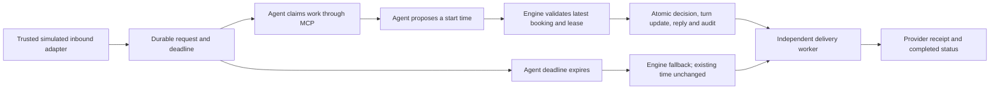

# Cleaner Core delegation prototype

This isolated local prototype exercises a cleaner requesting a different start
time. It uses the real MCP SDK over loopback HTTP, a scripted agent, and a
durable simulated message provider. It does not use live Grok, Guesty, Twilio,
real cleaners, or the existing touring tool registry.

Run from `/workspace/TourCore`:

```sh
node --import tsx scripts/demo-delegation.ts
```

The demo creates a fresh ignored folder under
`tourcore-data/delegation-prototype/run_*`. It verifies one accepted proposal,
the same action replayed without another reply, and one offline-agent fallback.
Its injected clock advances the two-minute deadline without waiting or changing
real bookings. It saves `report.json`, `delegation.json`, and `replies.json`, then
closes its worker, client, and temporary MCP server. No credentials are needed;
ephemeral local authentication is generated in memory and is not printed.

## Responsibility boundary



The agent selects a structured start time. The engine owns the recipient,
reply text, booking constraints, authorization, and completion status. This
simulation pre-authorizes scheduling inside the supplied cleaning window;
it does not infer permission to enter a property. Every confirmation explicitly
requires host clearance for entry.

## MCP contract

The prototype creates a separate stateless Streamable HTTP endpoint using the
installed SDK. Authentication binds both tenant and agent identity on the server;
the agent cannot choose tenant scope or a reply recipient in tool arguments.
Loopback host validation is enabled. These bindings are local prototype
credentials, not production OAuth grants.

| Tool | Purpose |
| --- | --- |
| `list_delegated_work` | Discover requests available to this authenticated tenant |
| `read_delegated_work` | Read current booking constraints and delivery status |
| `claim_delegated_work` | Obtain an expiring, agent-owned lease token |
| `propose_cleaning_time` | Submit a start time, current turn version, lease token, and stable action key |

`propose_cleaning_time` returning `accepted: true, completed: false` means the
validated action and reply are saved, not that a message reached its recipient.
Completion is recorded only after the message adapter returns a receipt and
the engine persists it. In this prototype a receipt means an entry in the
local provider ledger; it is not proof of carrier delivery.

Replaying the same action key and identical proposal returns its existing
status. Reusing that key for a different proposal is rejected. A second
distinct action cannot supersede a committed reply through this tool.

## Validation and recovery

- Persist inbound work before acknowledgment; deduplicate by tenant and source
  event ID. Conflicting contents under the same source ID are rejected.
- Validate the current lease owner/token and turn version. A stale booking
  version or expired lease cannot authorize a change.
- Require a future start inside the cleaning window, enough time for the
  minimum cleaning duration, and completion before the next arrival.
- Save the turn change, fixed recipient, response, decision, and audit in one
  atomic snapshot before sending. A booking change before the first send
  places the reply in review instead of sending an obsolete confirmation.
- Reclaim expired leases until the event deadline. At the exact deadline, the
  engine commits a deterministic fallback and refuses late agent actions.
  The fallback acknowledges the request and leaves the existing time unchanged.
- Run an independent worker, including after restart. Agent polling is not
  required for deadline fallback or reply delivery.
- Use the same reply key on every send attempt. Retry only when the adapter
  explicitly guarantees provider idempotency. The local simulated provider
  persists that guarantee across restart and lost acknowledgments.
- Limit send duration and attempts. Ambiguous sends through a provider without
  idempotency, exhausted attempts, or changed bookings become `review_required`.
  A pending HTTP request timing out does not prove that nothing was delivered.
- Damaged saved state fails closed; it is not silently reset. Worker errors
  are surfaced through the configured error callback.

The saved audit distinguishes request receipt, lease ownership, validated
action, timeout fallback, send attempts, retries, review, and completed delivery.
No webhook transport acceptance is treated as agent completion.

## Validation commands

```sh
npm run typecheck
npm run build
npm test -- test/delegationPrototype.test.ts --maxWorkers=1 --testTimeout=30000
npm test -- --maxWorkers=4 --testTimeout=30000
npm run test:eval -- --maxWorkers=2
```

Keep baseline evaluation sequential after the product suite. The prototype
suite covers SDK MCP flow, auth/scope boundaries, current-state validation,
leases, deadline fallback, concurrent sweeps, restart recovery, lost provider
acknowledgments, retry exhaustion, ambiguous delivery, and corrupt storage.

Verified on 11 October 2026: the runnable demo passed both agent and offline
cases; typecheck and build passed; all 1,686 product tests passed (including
17 prototype tests); all 26 baseline evaluation tests passed. The existing
touring server, tool registry, dependency manifests, and lockfile were unchanged.
This validation was performed locally. The separate Railway test build is
described in [Cleaner Core Railway setup](cleaner-railway-setup.md). Subsequent
account-reported hosted health and one full unattended Grok completion are
recorded in [the proof record](async-agent-proof.md); they are distinct from
this local validation.

## Practical limits and next integration

Only one engine process may write a given prototype directory. Its in-process
queue serializes operations; the file snapshot is not a database transaction or
a lock coordinating multiple processes. The local provider also assumes one
writer. Data and timers are for development; always-on deployment and persistent
storage need separate preparation. A full snapshot is rewritten on each change,
so this implementation is not intended for production load.

The reply adapter's `idempotent` property is an integration contract that must
be verified. Do not label a real SMS provider idempotent solely because the
engine supplies a key. Lost acknowledgments through a non-idempotent provider
require reconciliation rather than blind resend.

The local demo agent is scripted. The separate test service now includes durable
webhook wakeups for a dedicated Grok routine. One correlated live background
completion through its new connector has now been reported with the conversation
closed. Repeated reliability checks remain. There is no Guesty
reservation import, full cleaning-turn state machine, host review UI, OAuth
integration, or live messaging. Review state is inspectable in durable records;
operator review and resolution are a later integration.

Before live delegation, connect a verified agent adapter to this durable
contract, register completion reporting, verify tenant-scoped production
authentication, and reconcile real provider sends. Test timeout/replay and
booking changes on an isolated test installation. Keep touring behavior and
real provider settings unchanged until those integration checks pass.
